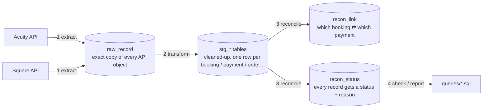
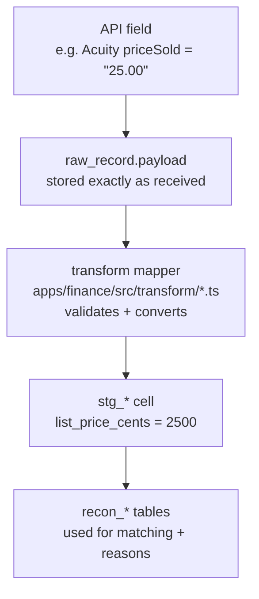

# The Mat — Finance Data Dictionary

**What this is:** a plain-language map of every table in the finance database. It covers what each column means, which API field it came from, and which step of the pipeline put it there.
**As of:** 2026-10-21. Describes the code **as built** in `apps/finance` (migrations `0001`–`0004`), not the PRDs. Differences from the PRDs are listed in [§9](#9-where-the-build-differs-from-the-prds).
**Audience:** owners and stakeholders (read §1–§2 and the "In plain English" box on each table) and engineers (everything).

---

## Contents
1. [The 60-second version](#1-the-60-second-version)
2. [What data we pull](#2-what-data-we-pull)
3. [How a value gets into a cell](#3-how-a-value-gets-into-a-cell)
4. [Raw layer: `raw_record`](#4-raw-layer)
5. [Cleaned-up layer: the `stg_*` tables](#5-cleaned-up-layer-staging)
6. [Reconciliation: matching Acuity ⇄ Square](#6-reconciliation-matching-acuity--square)
7. [Worked examples (real, anonymized)](#7-worked-examples-real-anonymized)
8. [Pipeline bookkeeping tables](#8-pipeline-bookkeeping-tables)
9. [Where the build differs from the PRDs](#9-where-the-build-differs-from-the-prds)
10. [Trace any number yourself](#10-trace-any-number-yourself)
11. [Glossary](#11-glossary)

---

## 1. The 60-second version

The studio's bookings live in **Acuity**; the money lives in **Square**. Every refresh does four things, always in this order:



| Step | Plain English | Can it change history? |
|---|---|---|
| **1. Extract** | Ask Acuity and Square for everything in a date range and keep an **exact copy** of each record. If a record changed since last time, the old copy is kept in an archive. | No. Nothing is ever deleted. |
| **2. Transform** | Turn each copy into a tidy row: money as whole cents, times in UTC, and a **studio-local (Los Angeles) date** on everything. | No. These tables are rebuilt from scratch every time. |
| **3. Reconcile** | Pair every Acuity booking/order with the Square payment that paid for it. Anything left unpaired gets a **reason code**, e.g. "package credit", "100% coupon" or "paid but no Square payment". | No. Also rebuilt from scratch every time. Only the manual-override table is human-edited. |
| **4. Check / report** | Run data-quality checks and report queries. | Read-only. |

**Three rules hold everywhere:**
- **Money is stored as whole cents** (`$25.00` → `2500`), so rounding errors are impossible.
- **Every cleaned-up row carries `raw_record_id`**, so any number can be traced back to the exact API record it came from.
- **Dates for reporting are Los Angeles dates** (`local_date`). Exact moments in time are stored in UTC (`…_at` columns).

---

## 2. What data we pull

| Source | What | API endpoint | Range pulled | Lands in raw as `entity` | Cleaned-up table |
|---|---|---|---|---|---|
| Acuity | Bookings (classes, private sessions, admin "appointments") | `GET /appointments?minDate&maxDate&showall` | Month by month over the seed range (`SEED_START`–`SEED_END`, currently **2020-03-01 → 2020-12-31**), each month padded ±1 day | `appointment` | `stg_acuity_appointment` |
| Acuity | Payments recorded against a booking | `GET /appointments/{id}/payments` | Only for bookings with **amount paid > $0** that are new, changed, or have no payments stored yet | `appointment_payment` | `stg_acuity_payment` |
| Acuity | Orders (packages, gift certificates, memberships bought online) | `GET /orders` | **Everything** (the API has no date filter), every run | `order` | `stg_acuity_order` |
| Acuity | Codes: packages, gift certificates, memberships | `GET /certificates` | Everything, every run | `certificate` | *none yet* (used to label `certificate_kind`) |
| Acuity | Class types | `GET /appointment-types` | Everything, every run | `appointment_type` | *none yet* |
| Acuity | Calendars (one shared calendar in practice; not per teacher) | `GET /calendars` | Everything, every run | `calendar` | *none yet* |
| Acuity | Products (what can be sold) | `GET /products` | Everything, every run | `product` | *none yet* |
| Square | Invoices (paid **and** unpaid) | `POST /v2/invoices/search` | Everything, every run | `invoice` | `stg_square_invoice` |
| Square | Payments (every status) | `GET /v2/payments` | Month by month over the seed range, by **when the payment was created**, padded ±1 day | `payment` | `stg_square_payment` |
| Square | Refunds | `GET /v2/refunds` | Same windows as payments | `refund` | `stg_square_refund` |
| Square | Orders (line items, discounts, tax, tip) | `POST /v2/orders/batch-retrieve` | Only the orders behind stored payments and invoices | `order` | `stg_square_order` + `stg_square_order_discount` |
| Square | Customers | `/v2/customers/bulk-retrieve` | Only customers referenced by stored payments, orders or invoices | `customer` | *none yet* (used to fill emails) |
| Square | Merged-customer redirects | (derived while fetching customers) | When Square says an old customer id was merged into another | `customer_alias` | *none* (used to follow merges) |

**Not pulled today:** Square subscriptions, Square catalog, Acuity class capacity/availability, Acuity intake forms, and phone/address data beyond what is inside the payloads above.

---

## 3. How a value gets into a cell

Every cell in a cleaned-up table goes through the same four hops:



**Step 1, extract** (`src/sources/*/extract.ts`, writing through `src/raw/repo.ts`). For each record, a **fingerprint** (`payload_hash`) is computed:
- **New** → inserted.
- **Same fingerprint as last time** → only `last_seen_at` and `last_sync_run_id` are updated.
- **Different fingerprint** → the old copy is moved to `raw_record_version`, then the row is overwritten.
- When a date range or list has been fully re-pulled, any stored record the API **no longer returned** gets `missing_since` set. It is never deleted.

**Step 2, transform** (`src/transform/load.ts` + `acuity.ts` / `square.ts`):
- **Wipes and reloads** every `stg_*` table inside **one database transaction**, so readers never see a half-built table.
- Each raw payload is checked against the fields we rely on.
- If one doesn't fit (missing field, unparseable date or money), it goes to `transform_error` instead of producing a wrong number.

**Step 3, reconcile** (`src/reconcile/rules.ts`, `classify.ts`, `run.ts`):
- **Wipes and rewrites** `recon_link` and `recon_status` in one transaction.
- Reads only the `stg_*` tables plus the human-owned `recon_manual_override`.

**Conversions used everywhere:**

| Conversion | Rule | Code |
|---|---|---|
| Money (Acuity) | Decimal text like `"25.00"` → integer cents `2500`, using integer math (never floating point). Sub-cent values are rejected. | `lib/money.ts decimalToCents` |
| Money (Square) | Already in cents (`amount_money.amount`). Currency must be `USD`, otherwise the row errors. | `lib/money.ts squareMoneyToCents` |
| Instants | Parsed **with** their own offset. Acuity sends `-0800` style offsets, normalized to `-08:00`. A timestamp with no offset is refused, except Acuity order times, which Acuity sends in the account timezone (LA) and are read as LA wall-clock. | `lib/time.ts` |
| `local_date` | The instant converted to an **America/Los_Angeles** calendar date (DST-aware). | `lib/time.ts localDateOf` |
| Emails | Trimmed + lower-cased; blank → `NULL`. Used as the main "same person" key. | `transform/types.ts normEmail` |

---

## 4. Raw layer

### `finance.raw_record`

> **In plain English:** a filing cabinet with one folder per API record, from both systems. The folder holds an exact photocopy of what the API sent, plus labels saying when we first saw it, last saw it, and whether the API has stopped returning it.

**One row per:** source × entity × source id. **Written by:** extract (upsert). **Never edited by hand.**

| Column | What it means | Where it comes from / how it's set |
|---|---|---|
| `id` | Our internal row number | Auto-assigned on first insert; never changes. Every `stg_*` row points back here via `raw_record_id`. |
| `source` | Which system | `'acuity'` or `'square'`, set by the extractor. |
| `entity` | What kind of record | See the `entity` column in [§2](#2-what-data-we-pull). |
| `external_id` | The record's id in its source system | The API's `id`. **Exception:** Acuity payments have no id, so we build a stable one: `<appointment id>:<created>:<processor>:<amount>` (with `#2`, `#3` added to exact duplicates). For `customer_alias`, it's the merged-away customer id. |
| `parent_external_id` | The record this one belongs to | Acuity payment → its appointment id; Square refund → its payment id; Square invoice → its order id; customer alias → the surviving customer id. Otherwise empty. |
| `payload` | The full API record, untouched | Exactly what the API returned. |
| `payload_hash` | Fingerprint for change detection | SHA-256 of the payload with keys sorted. **Ignored when fingerprinting:** Acuity `canClientCancel` / `canClientReschedule`, which flip on their own as time passes. Square customer `segment_ids` are sorted first, since Square shuffles them. |
| `source_created_at` | When the source says it was created | Acuity appointment `datetimeCreated`; Acuity payment `created`; Acuity order `time` (read as LA time); Square `created_at`. Empty for lookups. |
| `source_updated_at` | When the source says it last changed | Square `updated_at` (payments, refunds, orders, invoices, customers). Acuity doesn't provide one. |
| `window_date` | The LA date the date-range pull selects this record by | Acuity appointment → LA date of the **class**. Square payment/refund → LA date of **created_at**. Empty for records pulled in full or by id. |
| `first_seen_at` | First time any run saw it | Set on insert; never updated. |
| `last_seen_at` | Most recent run that saw it | Updated every time a run sees the record, changed or not. |
| `missing_since` | The API stopped returning it | Set when a run fully re-pulls the record's scope and it isn't there. Scopes: Acuity appointments → the month window; Acuity payments → the appointment's payments; lookups, Acuity orders and Square invoices → the whole list; Square payments/refunds → the month window; Square orders → the ids we asked for. **Cleared** automatically if it reappears. |
| `last_sync_run_id` | The run that last saw it | → `sync_run.id`. |

### `finance.raw_record_version`

> **In plain English:** the archive drawer. Whenever a record changes (a refund, a reschedule, a price edit), the previous photocopy is kept here first.

| Column | Meaning / how it's set |
|---|---|
| `id` | Auto row number. |
| `raw_record_id` | The `raw_record` row that changed. |
| `payload` | The **previous** payload, copied just before the overwrite. |
| `payload_hash` | The previous fingerprint. |
| `superseded_at` | When it was replaced (time of the run that saw the change). |

---

## 5. Cleaned-up layer (staging)

All `stg_*` tables are **rebuilt from `raw_record` on every `transform`**: emptied, then reloaded in one transaction. Never edit them by hand; fix the mapper and re-run instead. Each table has:
- `raw_record_id`: the exact raw row the line came from;
- `missing_since`: copied from raw, so records the API dropped are still visible and labeled, not silently removed.

### 5.1 `finance.stg_acuity_appointment`

> **In plain English:** one row per Acuity booking: who booked what, with which instructor, when, the list price, what they actually paid, and any code they used. Canceled bookings and no-shows are included and flagged.

**One row per:** Acuity appointment. **Source:** `raw_record` where `source='acuity' and entity='appointment'`. **Mapper:** `src/transform/acuity.ts toStgAcuityAppointment`.

| Column | What it means | Source field → rule |
|---|---|---|
| `appointment_id` | Acuity's booking id | `id` |
| `raw_record_id` | Trace back to the raw record | `raw_record.id` |
| `starts_at` | Class start time (UTC) | `datetime`, parsed with its own offset |
| `local_date` | **Class date in LA**, the date bookings report on | `starts_at` → LA date |
| `source_tz` | Timezone Acuity used for this calendar | `calendarTimezone` |
| `type_id` / `type_name` | Class / appointment type | `appointmentTypeID` / `type`. Includes admin types such as "Membership: Agreement…" that aren't real classes. |
| `calendar_id` / `calendar_name` | The Acuity calendar. ⚠️ **Not the instructor:** about 99.7% of 2020–2022 bookings are on one shared calendar, "Tejal Yoga Online". The teacher is usually named in `type_name` ("… with Gauree"); some types name several teachers, "TY Teachers", or nobody. | `calendarID` / `calendar` |
| `client_email_norm` | Client email, normalized | `email`, trimmed + lower-cased |
| `client_name` | Client name | `firstName` + " " + `lastName` |
| `list_price_cents` | Price **before** any code | `priceSold` → cents (falls back to `price` if absent) |
| `price_cents` | Price **after** any code (coupon, package, membership) | `price` → cents |
| `discount_cents` | How much a code took off | `list_price_cents − price_cents` |
| `amount_paid_cents` | What Acuity says was paid | `amountPaid` → cents |
| `tip_cents` | Tip added at booking | If **no code** was used: `max(amount_paid − price, 0)`; otherwise 0 |
| `code_extra_paid_cents` | Amount paid above price **when a code was used** (gift card top-up / prepayment, not a tip) | If a code was used: `max(amount_paid − price, 0)`; otherwise 0 |
| `paid` | Acuity's "paid" flag | `paid = "yes"`. ⚠️ Also "yes" when a code covered the whole price, so `paid` doesn't mean money moved. |
| `certificate_code` | Code used (coupon, package, gift, membership) | `certificate`, trimmed; blank → empty |
| `certificate_kind` | What kind of code it is | Looked up in Acuity `/certificates` (case-insensitive) by its `productType`: Subscription → `membership`, Gift → `gift`, Package → `package`. **Not found** and looks like an Acuity code (8 hex characters) → `certificate_deleted`; **not found** otherwise → `coupon` (coupons never appear in `/certificates`). |
| `is_canceled` | Booking was canceled | `canceled` |
| `no_show` | Marked no-show | `noShow` (missing → false) |
| `booked_at` | When the booking was made | `datetimeCreated` |
| `labels` | Acuity labels on the booking | `labels[].name` |
| `missing_since` | API stopped returning it | copied from raw |

### 5.2 `finance.stg_acuity_payment`

> **In plain English:** the payment lines Acuity recorded against a booking: card through Square, cash, refunds and adjustments. One booking can have several.

**One row per:** Acuity payment record. **Source:** raw `entity='appointment_payment'`. **Only exists for bookings with amount paid > $0.**

| Column | What it means | Source field → rule |
|---|---|---|
| `acuity_payment_key` | Our stable id for the payment | raw `external_id` (`<appt>:<created>:<processor>:<amount>`) |
| `raw_record_id` | Trace back | `raw_record.id` |
| `appointment_id` | The booking it belongs to | raw `parent_external_id` |
| `processor` | How it was paid | `processor` (`square`, `cash`, …) |
| `processor_txn_id` | The processor's transaction id | `transactionID`, trimmed; empty → NULL (cash). For Square this is the **Square order id (2020)** or the **Square payment id (later years)**, which drives match rule 1a. |
| `amount_cents` | Amount; **can be negative** (refunds/adjustments recorded in Acuity) | `amount` → cents |
| `paid_at` / `local_date` | When it was paid (UTC) / its LA date | `created` |
| `related_payments_count` | Acuity's count of related payments | `relatedPaymentsCount` |
| `missing_since` | API stopped returning it | copied from raw |

### 5.3 `finance.stg_acuity_order`

> **In plain English:** things bought through Acuity checkout that aren't a single booking: class packs, gift certificates, memberships.

**One row per:** Acuity order. **Source:** raw `entity='order'` (Acuity).

| Column | What it means | Source field → rule |
|---|---|---|
| `order_id` | Acuity order id | `id` |
| `ordered_at` / `local_date` | When it was ordered (UTC) / LA date | `time`, which Acuity sends **without** a timezone; read as LA wall-clock time |
| `total_cents` | Order total | `total` → cents |
| `status` | Order status | `status` (e.g. `paid`, `unpaid`; unpaid = abandoned checkout) |
| `title` | Order title | `title` |
| `product_summary` | What was bought | `products[]` → `"1× 10-Class Pack; …"` |
| `client_email_norm` | Buyer email, normalized | `email` |
| `raw_record_id`, `missing_since` | as above | |

### 5.4 `finance.stg_square_payment`

> **In plain English:** every Square payment attempt (completed, failed or canceled), with the amount, tip, refund, card fees, who paid, and which Acuity booking/order/membership the payment's note points to.

**One row per:** Square payment. **Source:** raw `source='square' and entity='payment'`. **Mapper:** `src/transform/square.ts toStgSquarePayment`.

| Column | What it means | Source field → rule |
|---|---|---|
| `payment_id` | Square payment id | `id` |
| `created_at` / `local_date` | When it was charged (UTC) / **LA date**, the date sales report on | `created_at` |
| `status` | `COMPLETED`, `FAILED`, `CANCELED`, … | `status`. Only `COMPLETED` moved money. |
| `amount_cents` | Amount charged **excluding tip** | `amount_money.amount` |
| `tip_cents` | Tip | `tip_money` (missing → 0) |
| `total_cents` | Amount + tip | `total_money`; if absent, `amount + tip` |
| `refunded_cents` | Refunded so far | `refunded_money` (missing → 0) |
| `fee_cents` | Square processing fees | **Sum** of `processing_fee[].amount_money` |
| `source_type` | Payment method family | `source_type` (`CARD`, `CASH`, `EXTERNAL`, …) |
| `square_product` | Which Square product took the payment | `application_details.square_product`. `ECOMMERCE_API` = charged by **Acuity**; `INVOICES` = Square invoice; others = Square POS/register. |
| `order_id` | The Square order behind it | `order_id` |
| `invoice_id` | The Square invoice, if any | Looked up: the stored invoice whose `order_id` = this payment's `order_id` |
| `customer_id` | Square customer | `customer_id`; **if blank** (common in 2020), the customer on the payment's **order**. Then followed through `customer_alias` if Square merged that customer into another. |
| `buyer_email_norm` | Payer email, normalized | `buyer_email_address`; **if blank**, the stored Square customer's `email_address` |
| `note` | Free-text note on the payment | `note`. ⚠️ Can contain client names; never logged. |
| `reference_id` | Square reference id | `reference_id` (empty in practice, per probe) |
| `acuity_ref_kind` | What the note points to in Acuity | Parsed from `note` (`src/sources/square/note.ts`): `appointment` (note starts with an appointment id), `order` ("Order #…"), `subscription` ("Subscription … - CODE" or 2020 "123456 (Plan)"), `dated` (2020 text with a class date but no id), `empty`, `other` |
| `acuity_ref` | The Acuity id from the note | the appointment / order / subscription id parsed above |
| `acuity_certificate_code` | Membership code from the note | trailing code in "Subscription …" notes, upper-cased |
| `raw_record_id`, `missing_since` | as above | |

### 5.5 `finance.stg_square_order` and `finance.stg_square_order_discount`

> **In plain English:** the receipt behind a Square payment: totals, discounts, tax, tip and a short list of what was bought. Discounts get their own table, one row per discount on the receipt.

**`stg_square_order`: one row per Square order.**

| Column | What it means | Source field → rule |
|---|---|---|
| `order_id` | Square order id | `id` |
| `created_at` / `local_date` | When created / LA date | `created_at` |
| `total_cents` | Order total | `total_money` |
| `discount_cents` | All discounts on the order | `total_discount_money` |
| `tax_cents` | Tax | `total_tax_money` |
| `tip_cents` | Tip | `total_tip_money` |
| `line_item_count` | Number of line items | count of `line_items[]` |
| `line_item_summary` | What was bought, as text | `line_items[]` → `"1× Drop-in; 1× Custom amount"`. ⚠️ Text only; there's no per-item table yet. |
| `source_name` | Where the order was created | `source.name` (e.g. `Invoices`) |
| `invoice` | Order belongs to an invoice | true if a stored invoice points at this order, or `source.name = 'Invoices'` |
| `raw_record_id`, `missing_since` | as above | |

**`stg_square_order_discount`: one row per discount on an order.**

| Column | What it means | Source field → rule |
|---|---|---|
| `order_id` + `discount_uid` | Which order / which discount line (together = the key) | order `id` / `discounts[].uid` |
| `name` | Discount name as set up in Square | `discounts[].name` |
| `type` | Fixed amount vs percentage | `discounts[].type` |
| `scope` | Whole order vs one line item | `discounts[].scope` |
| `applied_cents` | Money the discount took off | `discounts[].applied_money` |
| `raw_record_id` | The order's raw row | |

### 5.6 `finance.stg_square_refund`

> **In plain English:** every refund, dated on the day it was issued.

| Column | What it means | Source field → rule |
|---|---|---|
| `refund_id` | Square refund id | `id` |
| `payment_id` | The payment refunded | `payment_id` |
| `created_at` / `local_date` | When / LA date | `created_at` |
| `amount_cents` | Amount refunded | `amount_money` |
| `status` | Refund status | `status` (`COMPLETED`, `PENDING`, …) |
| `reason` | Reason entered | `reason` |
| `raw_record_id`, `missing_since` | as above | |

### 5.7 `finance.stg_square_invoice`

> **In plain English:** every Square invoice, paid or not. Many are membership / payment-plan charges for students who book in Acuity.

| Column | What it means | Source field → rule |
|---|---|---|
| `invoice_id` | Square invoice id | `id` |
| `order_id` | Order behind it | `order_id` |
| `invoice_number`, `title` | As shown on the invoice | `invoice_number`, `title` |
| `status` | `PAID`, `UNPAID`, `SCHEDULED`, `CANCELED`, `REFUNDED`, … | `status` |
| `created_at` / `local_date` | When created / LA date | `created_at` |
| `due_date` | Earliest due date | min of `payment_requests[].due_date` |
| `requested_cents` | Amount billed | sum of `payment_requests[].computed_amount_money` |
| `paid_cents` | Amount collected | sum of `payment_requests[].total_completed_amount_money` |
| `customer_id` | Billed customer | `primary_recipient.customer_id`, followed through `customer_alias` |
| `raw_record_id`, `missing_since` | as above | |

---

## 6. Reconciliation: matching Acuity ⇄ Square

> **In plain English:** for every Acuity booking or order, we look for the Square payment that paid for it, using the most reliable evidence first. When nothing matches, we record **why**: maybe no payment was expected (package credit, membership, 100% coupon, canceled), or there's a real gap someone should look at.

**When:** `npm run finance -- reconcile` (also the 3rd step of `run`). **Inputs:**
- every `stg_*` row;
- Acuity certificate codes from raw;
- `recon_manual_override`.

**Outputs:** `recon_link` and `recon_status`, both deleted and rewritten in one transaction.

**Scope:** links are computed across **all** loaded data. Statuses are written only for records whose `local_date` falls in the reconcile window (default `SEED_START`–`SEED_END`, currently **2020-03-01 → 2020-12-31**). Only **COMPLETED** Square payments can be matched.

### 6.1 What "expected" means for a booking
**Expected Square amount** = the sum of the booking's **non-cash** Acuity payments (refunds and adjustments included). If Acuity returned no payment records for it, `amount_paid_cents` is used instead. Bookings with an expected amount of $0 aren't looked for in Square.

### 6.2 The matching rules (run in this order; a record claimed by one rule isn't offered to later ones)

| Rule | Plain English | Exact test | Confidence |
|---|---|---|---|
| **0** | A person said so | A row in `recon_manual_override`. With a Square payment id: link them. Without one: "no payment expected". | manual |
| **1a** | Acuity wrote down Square's transaction id | `stg_acuity_payment.processor_txn_id` = a Square **payment id** *or* **order id**. Several Acuity payments may point at one Square payment. | high |
| **1b** | Square's note names the Acuity record | `stg_square_payment.acuity_ref_kind` = `appointment` / `order` and that id exists in Acuity. Or `subscription` with a certificate code Acuity knows, which links to the **membership code** (`acuity_kind='certificate'`). Membership codes are never "used up", so each monthly charge links to the same code. | high |
| **2** | Same person, same amount, within minutes | Same normalized email + Square amount = expected amount + Square time within **±15 min** (`MATCH_WINDOW_MINUTES`) of the first non-cash Acuity payment time (orders: order time). Closest in time wins. | medium |
| **3** | Same person, same day, only one candidate | Same email + same LA payment date, and **exactly one** unmatched candidate on each side. Amounts may differ. | low |
| **4** | Same amount, same day, only one candidate | Same amount + same LA payment date, exactly one candidate on each side, no email needed. | low |

**How much of the payment each link gets (`allocated_cents`):**
- If one Square payment pays **one** booking, the link gets the **whole** Square amount. Any difference then shows up as an amount mismatch on the booking.
- If one Square payment pays **several** bookings (rule 1a), it's split by each booking's Acuity amounts.

### 6.3 Status and reason codes (`recon_status`)
Every Acuity booking, Acuity order and Square payment in the window gets **one** status row. ⚑ = goes on the **exceptions list** (`exception = true`).

**Acuity bookings**

| Status | Reason code | When |
|---|---|---|
| `not_applicable` | *(override's reason)* | A manual override said "no payment expected" |
| `matched` | — | Linked, and Square amount = expected |
| `amount_mismatch` | `ACUITY_DISCOUNT` | Difference = the Acuity code discount |
| | `TIP` | Difference = tip (or code extra paid) |
| | `PARTIAL_REFUND` | Difference = amount refunded on the linked Square payment(s) |
| | `SQUARE_DISCOUNT` | Difference = discounts on the Square order |
| | `PRICE_OVERRIDE` | None of the above, and Acuity price ≠ amount paid |
| | ⚑ `UNKNOWN` | Unexplained difference |
| `acuity_only` | ⚑ **`PAID_NO_SQUARE`** | Acuity says money went through Square, but no Square payment matched. **The real gap.** Checked first, so it can never hide behind a reason below. |
| `not_applicable` | `CANCELED` | Canceled, no Square money expected |
| `not_applicable` | `CASH` | Paid, all payments recorded as cash |
| `not_applicable` | `PACKAGE_REDEMPTION` | Used a package / gift / deleted certificate, paid $0 |
| `not_applicable` | `MEMBERSHIP` | Used a membership code, or class type name contains "Membership" (`MEMBERSHIP_TYPE_PATTERNS`) |
| `not_applicable` | `COUPON_FULL` | Coupon covered the full price |
| `not_applicable` | `FREE_TYPE` | Price is $0 |
| `acuity_only` | `UNPAID` | Price > $0, not paid, not canceled |
| `acuity_only` | ⚑ `UNKNOWN` | None of the above |

**Acuity orders**

| Status | Reason | When |
|---|---|---|
| `matched` / `amount_mismatch` | `PARTIAL_REFUND`, ⚑ `ORDER_CHARGED_LESS` (probably a checkout coupon; Acuity's order API shows no discount), ⚑ `UNKNOWN` | Linked to Square |
| `not_applicable` | `ORDER_UNPAID` | Abandoned checkout |
| `not_applicable` | `FREE_TYPE` | Total is $0 |
| `acuity_only` | ⚑ `ORDER_NO_SQUARE` | Paid order, no Square payment found |

**Square payments**

| Status | Reason | When |
|---|---|---|
| `matched` | `LINKED_APPOINTMENT`, `LINKED_ORDER`, `LINKED_CERTIFICATE` (or combined, e.g. `LINKED_APPOINTMENT+ORDER`) | Its links add up to the payment |
| `amount_mismatch` | `PARTIAL_REFUND`, `ALLOCATION_DIFFERS` | Links don't add up to the payment |
| `not_applicable` | `NOT_COMPLETED` | Failed/canceled attempt; no money moved |
| `square_only` | `CLASS_OUTSIDE_WINDOW` | 2020 note names a class date outside the loaded range |
| `square_only` | ⚑ `ACUITY_ORDER` | Note names an Acuity order we don't have |
| `square_only` | `MEMBERSHIP_CHARGE` | Recurring membership charge whose code isn't in Acuity's list |
| `square_only` | `INVOICE` | Square invoice payment |
| `square_only` | `POS_RETAIL` | Taken at the Square register / other Square product |
| `square_only` | ⚑ `NO_ACUITY_REF` | Charged via Acuity's integration but no reference we can use |

**Reading `recon_status` safely:** a matched booking **and** its Square payment each have a row. **Never add up money across both sides**; filter on `side` first.

### 6.4 Known limitations
- **2020 "dated" Square notes** contain a class date and a client name but **no id**, so those payments depend on rules 2–4.
- **Rules 3 and 4 are low confidence** by design. Rule 4 pairs on amount + date alone, and only when there's exactly one candidate on each side.
- **2020 membership notes** (`123456 (Plan)`) carry no certificate code, so they can't link to a specific membership. They show as `MEMBERSHIP_CHARGE`.
- **Statuses only cover the reconcile window.** Widening the analysis means extracting and reconciling over a wider range.

---

## 7. Worked examples (real, anonymized)

These are **real records** from the 2020 data, exported with `queries/docs/lineage_examples.sql` on 2026-10-21. Names, emails and notes were masked inside the database before export; ids, dates and amounts are real.

### 7.1 What's loaded today (Mar 1 – Dec 31, 2020)

| Record | Rows | Cleaned-up rows | Notes |
|---|---|---|---|
| Acuity bookings | 1,896 | 1,896 | Class dates Mar 2, 2020 – Jan 1, 2021 (padding adds a day each side) |
| Acuity payment lines | 674 | 674 | Only fetched for bookings with amount paid > $0 |
| Acuity orders | 1,482 | 1,482 | Pulled in full: **all years, 2020 → Sep 2026** |
| Acuity codes / class types / calendars / products | 1,025 / 59 / 5 / 34 | — | No cleaned-up tables yet |
| Square payments | 980 | 980 | |
| Square orders | 1,161 | 1,161 | Includes orders behind invoices from all years |
| Square order discounts | — | **0** | No Square-side discounts in 2020; all discounts came from Acuity codes |
| Square refunds | 3 | 3 | Aug–Nov 2020 |
| Square invoices | 199 | 199 | Pulled in full: **2018 → Oct 2026** |
| Square customers / merged-customer redirects | 309 / 267 | — | |
| Rows that failed to transform | | **0** | |
| Missing (API stopped returning) | **0** across all entities | | |

**Reconciliation results (statuses written for Mar–Dec 2020):** 811 links, 3,020 status rows, **20 exceptions**.

| Side | Status / reason | Rows | $ | Exception? |
|---|---|---|---|---|
| Acuity | matched | 798 | $19,230.93 | |
| Acuity | `PACKAGE_REDEMPTION` | 523 | — | |
| Acuity | `MEMBERSHIP` | 321 | — | |
| Acuity | `FREE_TYPE` | 220 | — | |
| Acuity | `CANCELED` | 97 | — | |
| Acuity | `COUPON_FULL` | 61 | — | |
| Acuity | `ORDER_UNPAID` / `UNPAID` / `CASH` | 7 / 4 / 2 | — | |
| Acuity | **`PAID_NO_SQUARE`** | **0** | — | ⚑ |
| Acuity | `ORDER_CHARGED_LESS` | 8 | expected $698.00, charged $392.25 | ⚑ |
| Acuity | `UNKNOWN` (unmatched / mismatch) | 2 / 1 | — / +$16.00 | ⚑ |
| Square | matched to a booking / to an order | 625 / 141 | $12,331.63 / $7,342.75 | |
| Square | `MEMBERSHIP_CHARGE` | 118 | $6,913.00 | |
| Square | `NOT_COMPLETED` | 77 | — | |
| Square | `NO_ACUITY_REF` | 8 | $131.20 | ⚑ |
| Square | `CLASS_OUTSIDE_WINDOW` / `POS_RETAIL` / `ACUITY_ORDER` | 4 / 2 / 1 | $97.20 / — / $9.00 | ⚑ (`ACUITY_ORDER` only) |

**Rules that did the matching:** 669 links by **1a** (Acuity's transaction id), 138 by **1b** (Square note → order), 2 by **3** and 2 by **4** (low confidence, all orders). Rule 2 never fired.

**What this tells us:**
- **No paid booking is missing its Square payment in 2020.** The gaps are elsewhere: 8 order totals that were charged less (probably checkout coupons Acuity's order API doesn't expose), 8 Square payments with no usable reference, and 3 unexplained bookings. That's 20 rows to review.
- **$6,913 of 2020 membership revenue sits in Square only.** 2020 membership notes carry no membership code, so those 118 charges can't link to a membership in Acuity. They're explained, not errors.
- **Acuity labels record check-ins.** Bookings carry an Acuity label named "Checked In", which answers the stakeholders' attendance question (Q4).

### 7.2 Example A: a booking paid online and matched

A $15 drop-in, "Yoga Practice (W 5:30p)", on Apr 1, 2020, paid by card when booked on Mar 30.

| Hop | Table | Key values | How they got there |
|---|---|---|---|
| 1 | `raw_record` (acuity / appointment) `#2607` | `id` 369277389 · `datetime` "2020-04-01T17:30:00-0700" · `priceSold` "15.00" · `price` "15.00" · `amountPaid` "15.00" · `paid` "yes" · `certificate` null · `classID` 32975190 · `labels` [Checked In] | Acuity `/appointments` for the April window. First seen 2026-10-16; never changed (0 versions). |
| 2 | `raw_record` (acuity / appointment_payment) `#2656` | key `369277389:2020-03-30T05:44:25-0700:square:15.00` · `processor` square · `transactionID` q5HG…eV | Fetched because amount paid > $0. Key built from appointment + created + processor + amount, since Acuity payments have no id. |
| 3 | `stg_acuity_appointment` | `starts_at` 2020-04-02 00:30 UTC · **`local_date` 2020-04-01** · `list_price_cents` 1500 · `price_cents` 1500 · `discount_cents` 0 · `amount_paid_cents` 1500 · `tip_cents` 0 · `labels` {Checked In} | 5:30pm at −07:00 = 00:30 UTC the next day, which is Apr 1 in LA. Discount = 1500 − 1500. No tip, since paid = price. |
| 4 | `stg_acuity_payment` | `processor_txn_id` q5HG…eV · `amount_cents` 1500 · `local_date` 2020-03-30 | `transactionID` kept as-is. In 2020 it's a **Square order id**. |
| 5 | `raw_record` (square / payment) `#5377` | `id` VEN0…aB · `amount_money` 1500 · `processing_fee` [74] · `order_id` q5HG…eV · `customer_id` null · `square_product` ECOMMERCE_API · card `ON_FILE` · note "[masked]" | Square `/v2/payments`, March window. |
| 6 | `stg_square_payment` | **`local_date` 2020-03-30** · `amount_cents` 1500 · `fee_cents` 74 · `customer_id` BMRT…VM · `buyer_email_norm` filled · `acuity_ref_kind` **dated** (no id) | The payment had no customer, so the **order's** customer (JWXT…Z0) was used, then followed through a merged-customer redirect to BMRT…VM; the email came from that customer. The 2020 note has a date but no Acuity id. |
| 7 | `stg_square_order` | `total_cents` 1500 · `discount_cents` 0 · `line_item_summary` "1× Custom amount" | Square `/v2/orders/batch-retrieve`, fetched because the payment references it. |
| 8 | `recon_link` | **rule `1a`**, high · `allocated_cents` 1500 · evidence `{"acuity_transaction_id_matches":"order_id"}` | Acuity's `transactionID` equals the Square payment's `order_id`. |
| 9 | `recon_status` | Acuity: **matched**, expected 1500 = actual 1500. Square: **matched**, `LINKED_APPOINTMENT`. | |

> **Reporting note:** the booking reports on its **class date (Apr 1)** and the money on its **payment date (Mar 30)**. That's correct, and it's why bookings and cash can land in different days or months.

### 7.3 Example B: a booking that needed no payment

"Yoga: Movement (T/Th 1p)", Mar 31, 2020, paid with a code.

| Hop | Table | Key values | How they got there |
|---|---|---|---|
| 1 | `raw_record` (acuity / appointment) `#2630` | `priceSold` "10.00" · `price` "0.00" · `amountPaid` "0.00" · `paid` **"yes"** · `certificate` 8E35CF83 | |
| — | `stg_acuity_payment` | *(no rows)* | Payments are only fetched when amount paid > $0. |
| 2 | `stg_acuity_appointment` | `list_price_cents` 1000 · `price_cents` 0 · **`discount_cents` 1000** · `amount_paid_cents` 0 · `certificate_kind` **certificate_deleted** | Code 8E35CF83 isn't in Acuity's current `/certificates` list, and it's 8 hex characters, so it's an Acuity-issued package/gift code that has since been deleted. |
| 3 | `recon_status` | **not_applicable**, `PACKAGE_REDEMPTION`, expected 0 | Code of kind package/gift/deleted and $0 paid, so no Square payment is expected. |

> **Reporting note:** Acuity says `paid = yes` even though no money moved. That's why reports use `amount_paid_cents`, never `paid`.

### 7.4 Example C: a Square payment with no booking

A $9.00 card charge on Jun 16, 2020.

| Hop | Table | Key values | How they got there |
|---|---|---|---|
| 1 | `raw_record` (square / payment) `#5945` | `amount_money` 900 · `processing_fee` [56] · note "212348 … [masked]" · `square_product` ECOMMERCE_API | |
| 2 | `stg_square_payment` | `acuity_ref_kind` **subscription** · `acuity_ref` 212348 · `acuity_certificate_code` **null** · `fee_cents` 56 | The note matches the 2020 membership format `123456 (Plan name)`, which has a subscription id but no membership code. |
| 3 | `recon_link` | *(none)* | Rule 1b needs a membership code to link; 2020 notes don't carry one. |
| 4 | `recon_status` | **square_only**, `MEMBERSHIP_CHARGE`, expected 900, not an exception | Explained: a recurring membership charge. |

### 7.5 Example D: a match where the amounts differ ⚑

A $16 class on Dec 30, 2020, booked Dec 27.

| Hop | Table | Key values | How they got there |
|---|---|---|---|
| 1 | `stg_acuity_appointment` | `price_cents` 1600 · `amount_paid_cents` 1600 · no code | |
| 2 | `stg_acuity_payment` | `amount_cents` 1600 · `processor_txn_id` O5eI…eV · `local_date` 2020-12-27 | |
| 3 | `stg_square_payment` | **`amount_cents` 3200** · `fee_cents` 123 · `order_id` O5eI…eV · note "dated" | |
| 4 | `recon_link` | rule `1a`, high · **`allocated_cents` 3200** | Only **one** loaded booking points at this Square order, so it gets the whole payment ([§6.2](#62-the-matching-rules-run-in-this-order-a-record-claimed-by-one-rule-isnt-offered-to-later-ones)). |
| 5 | `recon_status` | Acuity: **amount_mismatch**, `UNKNOWN`, expected 1600, actual 3200, **Δ +1600**, ⚑ exception. Square: matched. | No explanation fits (not a discount, tip, refund or Square discount). |

> **Most likely cause:** one checkout paid for **two** $16 classes, and the second class is dated **after Dec 31, 2020**, so it isn't loaded yet. Once 2021 is loaded, rule 1a should see both bookings and split the $32. This should clear on its own. If it doesn't, it gets a manual override.

---

## 8. Pipeline bookkeeping tables

| Table | In plain English | Columns (how set) |
|---|---|---|
| `schema_migrations` | Which database-structure files have been applied | `filename`, `checksum` (refuses to run if an applied file was later edited), `applied_at`. Written by `migrate`. |
| `sync_run` | One row per command run: what ran, over which dates, and how it went | `id`; `job` (`extract`, `transform`, `reconcile`, …); `source` (`acuity`/`square`/empty); `window_start`/`window_end` (LA dates); `status` (`running` → `succeeded`/`failed`); `started_at`/`finished_at`; `api_calls`; `rows_new`/`rows_changed`/`rows_unchanged`; `error`. Opened when a command starts and always closed, even on failure. |
| `sync_cursor` | "Resume from here" bookmarks for long pulls | `key` (e.g. `acuity:appointment:2020-03-01..2020-12-31`), `value` (last finished month, e.g. `2020-07`), `updated_at`. Saved after each month; used by `extract --resume`. |
| `transform_error` | Raw records that couldn't be turned into a clean row | `raw_record_id`, `entity` (e.g. `acuity.order`), `message` (which field failed and why), `sync_run_id`, `created_at`. Cleared and rewritten with each transform. |
| `recon_manual_override` | **Human-owned** corrections to matching | `acuity_kind` (`appointment`/`order`), `acuity_id`, `square_payment_id` (empty = "no payment expected"), `reason_code` (e.g. `COMP`, `MANUAL_MATCH`), `note`, `created_at`. Added with SQL; never touched by any job. |
| `recon_link` | Which Acuity record ⇄ which Square payment | `acuity_kind` (`appointment`/`order`/`certificate`), `acuity_id`, `square_payment_id`, `rule` (`0`,`1a`,`1b`,`2`,`3`,`4`), `confidence`, `allocated_cents` (§6.2), `evidence` (JSON: which fields matched, e.g. `{"email":true,"minutes_apart":2}`), `sync_run_id`. |
| `recon_status` | Status + reason for every record in the window | `side`, `kind`, `id`, `local_date` (class date for bookings, order date, payment date for Square), `status`, `reason_code`, `exception`, `expected_cents`, `actual_cents`, `delta_cents` (= actual − expected), `sync_run_id`. |

**Data checks** (`apps/finance/queries/checks/*.sql`, run by `check`; each returns zero rows when healthy): `staging_counts_match_raw`, `staging_missing_local_date`, `transform_errors`, `negative_amounts`, `recon_allocations`, `recon_status_complete`, `square_completed_payment_without_order`.

**Privacy:** every finance table has row-level security on with no policies, and Supabase's public API roles are revoked, so only the pipeline's database login can read them.

---

## 9. Where the build differs from the PRDs

| Area | PRD said | Built |
|---|---|---|
| Loading data | `seed` command with plan, per-chunk tracking, adaptive split, `seed verify` (PRD v3 §11) | `extract` command with a monthly `sync_cursor` for `--resume`. It **fails** if a month returns ≥ 5,000 bookings instead of splitting. No `seed verify` yet. |
| Raw layer | `raw_record` + versions | Same, plus `window_date` (the LA date a record is pulled by) |
| Acuity lookups and Square customers | Landed in raw | Landed in raw, but **no cleaned-up tables yet**; used only to fill `certificate_kind`, `customer_id` and `buyer_email_norm` |
| `stg_acuity_appointment` | price, amount paid, code | Adds `list_price_cents`, `discount_cents`, `tip_cents`, `code_extra_paid_cents`, `labels`; `certificate_kind` adds `certificate_deleted`. **No `class_id`** (Acuity's `classID` is in raw only). |
| `stg_square_payment` | core fields + `acuity_ref` | Adds `square_product`, `invoice_id`, `acuity_ref_kind`, `acuity_certificate_code` |
| Square invoices | Stretch goal | Built: `stg_square_invoice`, paid and unpaid |
| Square line items | — | Text summary only (`line_item_summary`), no per-item table |
| Match rule 1 | One rule | Split into **1a** (Acuity's transaction id) and **1b** (Square's note), plus memberships linking to a **certificate** |
| Reason codes | PRD §9 list | Adds `ACUITY_DISCOUNT`, `CASH`, `ORDER_UNPAID`, `ORDER_NO_SQUARE`, `ORDER_CHARGED_LESS`, `MEMBERSHIP_CHARGE`, `CLASS_OUTSIDE_WINDOW`, `NOT_COMPLETED`, `LINKED_*`, `ALLOCATION_DIFFERS`; plus an explicit `exception` flag |
| UI run tracking (UI PRD `0005`) | Planned | Not built |
| History loaded | 2020-03 → 2020-12 to start | Same; no later years yet |
| Version control | — | ⚠️ All `apps/finance` work is **uncommitted** in git |

---

## 10. Trace any number yourself

```sql
-- From a cleaned-up row back to the exact API record (swap in any stg_* table / id)
select r.source, r.entity, r.external_id, r.first_seen_at, r.last_seen_at, r.missing_since, r.payload
  from finance.stg_acuity_appointment a
  join finance.raw_record r on r.id = a.raw_record_id
 where a.appointment_id = 123456789;

-- Every earlier version of that record
select superseded_at, payload from finance.raw_record_version where raw_record_id = <id> order by superseded_at;

-- How a booking was matched, and why
select * from finance.recon_link   where acuity_kind = 'appointment' and acuity_id = '123456789';
select * from finance.recon_status where side = 'acuity' and kind = 'appointment' and id = '123456789';

-- Rows that failed to transform, and why
select entity, message, count(*) from finance.transform_error group by 1, 2 order by 3 desc;
```

Run any of these with `npm run finance -- query <file.sql>` or in Supabase Studio's SQL editor.

---

## 11. Glossary

| Term | Meaning |
|---|---|
| **Raw / raw record** | An exact copy of one API record, as received |
| **Staging / cleaned-up table** | A `stg_*` table: typed, tidy rows rebuilt from raw |
| **Cents** | All money is stored as whole cents: `$25.00` = `2500` |
| **Instant (`…_at`)** | An exact moment in time, stored in UTC |
| **`local_date`** | The calendar date in Los Angeles. Used for all daily/monthly reporting. |
| **Window** | The date range a command works on (`--from` / `--to`, default `SEED_START`–`SEED_END`) |
| **Padded window** | The window plus one day on each side, so records near midnight or timezone edges aren't missed |
| **Fingerprint (`payload_hash`)** | A short code that changes when a record's content changes; used to tell new/changed/unchanged apart |
| **Code / certificate** | Anything entered at Acuity checkout: coupon, package, gift certificate, membership |
| **Exception** | A reconciliation result that needs a person to look at it |
| **Run** | One execution of a command, recorded in `sync_run` |
